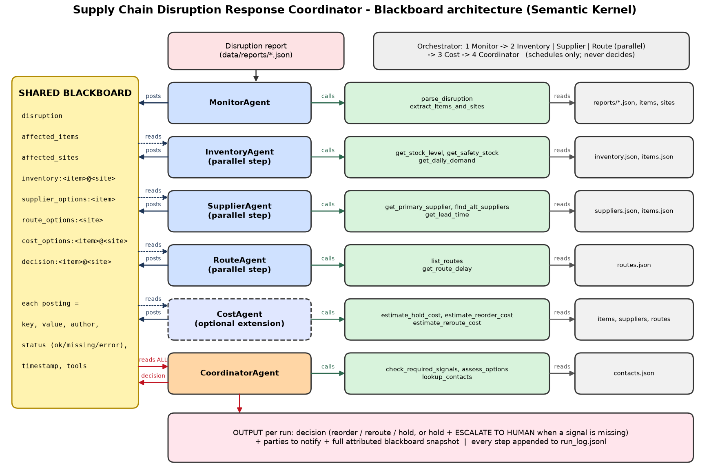

# Supply Chain Disruption Response Coordinator

A **blackboard multi-agent system** built on [Microsoft Semantic Kernel](https://github.com/microsoft/semantic-kernel). It reads a plain-text disruption report, such as a late supplier, a stockout or a blocked route, and decides whether to **reorder, reroute or hold**. It also lists who to notify and shows the evidence behind the decision. When evidence is missing, it does not guess: it **holds and escalates to a human**.


## Contents

- [Highlights](#highlights)
- [Architecture](#architecture)
- [Agents and tools](#agents-and-tools)
- [How a decision is made](#how-a-decision-is-made)
- [Getting started](#getting-started)
- [Sample results](#sample-results)
- [Running with an LLM](#running-with-an-llm)
- [Tests](#tests)
- [Project structure](#project-structure)
- [Assumptions and limitations](#assumptions-and-limitations)
- [Author](#author)

## Highlights

- **Six agents, one shared blackboard.** Agents never call each other. They post findings and read what others posted.
- **Traceable decisions.** Every posting carries its author, status, tools used and a UTC timestamp, and decisions cite the blackboard keys behind them.
- **Honest failure.** Missing data is posted as missing, malformed signals are detected, and the Coordinator escalates instead of inventing a number.
- **Deterministic core.** Fixed rules make the decision. An LLM can only reword explanations, and a decision rationale is discarded if it fails validation.
- **Runs without an API key.** Offline mode uses the same Semantic Kernel code path with no network calls.
- **Append-only audit log.** Tool calls, postings and escalations are appended to `run_log.jsonl`.

## Architecture



```
Disruption report
      │
      ▼
MonitorAgent ──► InventoryAgent ┐
                 SupplierAgent  ├ in parallel ──► CostAgent ──► CoordinatorAgent ──► decision
                 RouteAgent     ┘
```

The arrows show scheduling order; all data passes through the blackboard. `orchestrator.py` only schedules the agents and never decides anything. A disruption needs facts from several specialists, and a blackboard lets each one contribute independently and makes gaps visible. See [architecture.md](architecture.md) for the Mermaid source and the control-flow table.

## Agents and tools

Each agent is a module in `agents/` wrapping a Semantic Kernel `ChatCompletionAgent`. Its tools are plain Python functions marked with `@kernel_function`, registered as a kernel plugin.

| Agent | Role | Tools | Posts |
|---|---|---|---|
| **MonitorAgent** | Parses the raw report | `parse_disruption`, `extract_items_and_sites` | `disruption`, `affected_items`, `affected_sites` |
| **InventoryAgent** | Compares stock with safety stock | `get_stock_level`, `get_safety_stock`, `get_daily_demand` | `inventory:<item>@<site>` |
| **SupplierAgent** | Finds alternative suppliers and lead times | `get_primary_supplier`, `find_alt_suppliers`, `get_lead_time` | `supplier_options:<item>` |
| **RouteAgent** | Finds alternative routes and delays | `list_routes`, `get_route_delay` | `route_options:<site>` |
| **CostAgent** *(optional extension)* | Prices every option | `estimate_hold_cost`, `estimate_reorder_cost`, `estimate_reroute_cost` | `cost_options:<item>@<site>` |
| **CoordinatorAgent** | Decides from the blackboard only | `check_required_signals`, `assess_options`, `lookup_contacts` | `decision:<item>@<site>` |

## How a decision is made

1. **Completeness.** Every required signal must be present, `ok` and well-formed. Otherwise the result is **HOLD + ESCALATE TO HUMAN**, naming each gap and where it came from.
2. **Viability.** Each priced option is checked against fixed rules:

   | Option | Viable when | Cost |
   |---|---|---|
   | Hold | Stock is at or above safety stock **and** days of cover ≥ the delay | shortfall × stockout penalty |
   | Reorder | Supplier lead time ≤ needed-by days | quantity × unit price + order fee |
   | Reroute | The disruption is a route block **and** the route arrives within the needed-by days | shipment cost + quantity × per-unit cost |

3. **Selection.** The cheapest *viable* option wins. If none is viable, the result is hold + escalate.
4. **Notification.** A rule table selects procurement, suppliers, carriers, warehouse managers or customer service. Customer service is included when stock will run out before relief arrives, and on every escalation.

## Getting started

Developed and tested with **Python 3.12** on Windows.

```bash
git clone https://github.com/Arpita-2755/supply-chain-disruption-coordinator.git
cd supply-chain-disruption-coordinator

python -m venv .venv
.venv\Scripts\activate             # Windows
# source .venv/bin/activate        # Linux / macOS

pip install -r requirements.txt
```

Run it:

```bash
python orchestrator.py                                    # all six sample reports
python orchestrator.py data/reports/03_route_block.json   # a single report
```

Re-execute the demo notebook:

```bash
python -m nbconvert --to notebook --execute --inplace demo.ipynb
```

To try your own scenario, copy a file in `data/reports/`, edit its `text`, and pass the new path to `orchestrator.py`. Start the text with a heading such as `SUPPLIER DELAY:`, `STOCKOUT:` or `ROUTE BLOCKED:`, use item and site IDs that exist in `data/`, and state the deadline in a phrase such as "due in 7 days".

## Sample results

Results of running `python orchestrator.py` in offline mode:

| Report | Situation | Decision |
|---|---|---|
| `01_supplier_delay` | Battery packs 10 days late, needed in 7 | **Reorder** from SUP-03, $35,100 |
| `02_stockout` | Aluminium frames at zero stock | **Reorder** from SUP-04, $13,976 |
| `03_route_block` | Flooded lane into Kolkata | **Reroute** via RT-04, $2,790 |
| `04_missing_data` | Stock record missing after a sync failure | **Hold + escalate to human** |
| `05_conflicting` | Reorder ($3,450) and reroute both viable | **Reroute** via RT-06, $870 |
| `06_false_alarm_hold` | 2-day delay with 26.7 days of cover | **Hold**, $0 |

In report 1, the cheapest options overall were not chosen because they were not viable. In report 4, the Coordinator explains its refusal (output wrapped for readability):

```
>>> DECISION for ITM-008 @ WH-BLR: HOLD + ESCALATE TO HUMAN
    Rationale: HOLD + ESCALATE TO HUMAN: required blackboard signals missing or malformed:
    inventory:ITM-008@WH-BLR [missing; InventoryAgent: no stock record for ITM-008 at WH-BLR];
    cost_options:ITM-008@WH-BLR [missing; CostAgent: cannot price, missing: inventory:ITM-008@WH-BLR].
    The Coordinator will not guess.
```

Full traces are in [demo.ipynb](demo.ipynb).

## Running with an LLM

Copy `.env.example` to `.env`, then fill in **one** provider. `.env` is git-ignored; never commit your keys.

| Provider | Variables |
|---|---|
| OpenAI | `OPENAI_API_KEY`, optional `OPENAI_MODEL` |
| OpenAI-compatible endpoint (such as Ollama, LM Studio or Groq) | `OPENAI_API_KEY`, `OPENAI_BASE_URL`, `OPENAI_MODEL` |
| Azure OpenAI | `AZURE_OPENAI_API_KEY`, `AZURE_OPENAI_ENDPOINT`, `AZURE_OPENAI_DEPLOYMENT` |

`SCC_MODE` selects the mode:

| Value | Behaviour |
|---|---|
| `auto` (default) | Uses an LLM if credentials exist, otherwise runs offline |
| `offline` | Always deterministic, with no network calls |
| `llm` | Requires credentials and raises an error without them |

Tools and decisions are the same in every mode. The LLM only words the explanations.

## Tests

```bash
pytest -q
```

The 14 tests cover the main scenarios, refusal on missing signals, malformed input, cheapest-viable selection, posting attribution, tool usage per agent, the append-only log, offline mode, and rejection of an LLM rationale that contradicts the decision. Tests run offline and write to a temporary log.

## Project structure

```
├── agents/              # one module per agent, plus shared base_agent.py
├── tools/               # @kernel_function tools, grouped by agent
├── data/                # JSON data: items, sites, stock, suppliers, routes, contacts
│   └── reports/         # six sample disruption reports
├── tests/               # pytest suite
├── blackboard.py        # Posting and the thread-safe Blackboard
├── orchestrator.py      # schedules agents and prints the trace (entry point)
├── config.py            # offline / LLM mode selection
├── offline_llm.py       # deterministic stand-in for a chat service
├── run_log.py           # append-only JSONL logger
├── run_log.jsonl        # log from actual runs
├── demo.ipynb           # executed walkthrough
├── architecture.md      # Mermaid diagram and control flow
├── architecture.png     # rendered diagram
└── make_diagram.py      # draws architecture.png with matplotlib
```

## Assumptions and limitations

- The scenario, figures and contact details are invented for demonstration: 8 items, 4 warehouses, 5 suppliers and 6 routes.
- Reports are parsed with rules, so they need known IDs and a deadline such as "due in", "within" or "stops in N days". A report without a deadline is malformed and escalates.
- Supplier lead time includes delivery to the site, and the cost model is deliberately simple.
- Each run is single-shot and the blackboard lives in memory. Notifications are listed, not sent.

## Author

**Arpita Mishra**, Group 6 (solo project)<br>
CSE476 Agentic AI and Intelligent Automation, instructor Rohit Bharti<br>
School of Computer Science and Engineering, Lovely Professional University
