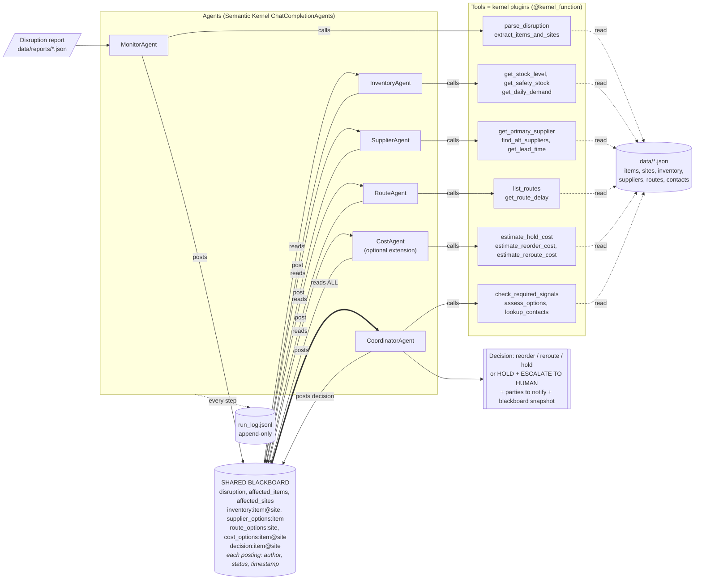

# Architecture - Supply Chain Disruption Response Coordinator

**Group 6, Supply Chain Disruption Response Coordinator**
Student: Arpita Mishra
Course: CSE476 Agentic AI and Intelligent Automation | Instructor: Rohit Bharti | School of Computer Science and Engineering, Lovely Professional University

Rendered image: [`architecture.png`](architecture.png) (drawn by `make_diagram.py` with matplotlib).

## Data flow (Mermaid)

## Control flow (orchestrator.py)

| Step | Agent(s) | Runs | Reads from blackboard | Posts to blackboard |
|---|---|---|---|---|
| 1 | MonitorAgent | alone | - (reads the report) | `disruption`, `affected_items`, `affected_sites` |
| 2 | InventoryAgent, SupplierAgent, RouteAgent | **in parallel** (`asyncio.gather`) | `affected_*`, `disruption` | `inventory:*`, `supplier_options:*`, `route_options:*` |
| 3 | CostAgent | alone | all step-1 and step-2 postings | `cost_options:*` |
| 4 | CoordinatorAgent | alone | **everything** | `decision:*` |

The orchestrator only schedules agents. It never makes or changes decisions.

## Guard rails on the Coordinator

1. **Completeness check** (`check_required_signals`). Every required key must exist, have status `ok`, and contain its required non-null fields. If any key fails, the Coordinator decides **HOLD + ESCALATE TO HUMAN**. The reason names each missing key and the agent responsible.
2. **Viability** (`assess_options`): fixed rules, as follows:
   - **Hold** needs stock at or above safety stock, with days of cover at least as long as the delay.
   - **Reorder** needs supplier lead time ≤ needed-by days.
   - **Reroute** needs a route-block disruption and an alternative route arriving within the needed-by days.
3. **Selection**: the cheapest *viable* option. If nothing is viable, the Coordinator holds and escalates.
4. **Rationale**: in LLM mode the model may reword the rationale. The text is rejected and replaced by the deterministic draft if:
   - it does not name the chosen action,
   - it does not cite a blackboard key, or
   - its first sentence argues for another action.
